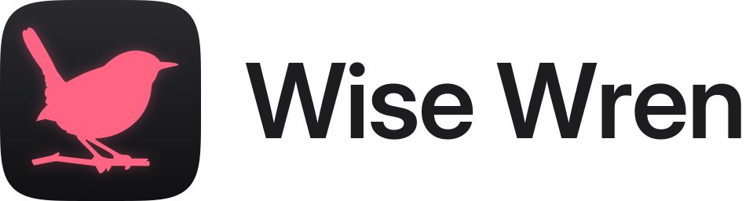

<p align="center">
  <picture>
    <source media="(prefers-color-scheme: dark)" srcset="assets/brand/wren-logo-dark.svg">
    
  </picture>
</p>

<p align="center"><strong>Keeps your Docker containers up to date, without surprises.</strong></p>

<p align="center">
  <a href="LICENSE"></a>
  <a href="https://hedgerow.tools/Wise-Wren/"></a>
</p>

> **Status: early release (Docker images only).** Wren lists what runs on each server (containers, Unraid
> template containers, Compose stacks and script-updated stacks), checks for new versions and updates what you
> approve, now or at a time you choose, with a snapshot, a health check and an automatic rollback. Automatic
> updates inside a window, the [Vigilant Vole](https://hedgerow.tools/Vigilant-Vole/) integration (maintenance
> windows and monitor-based health checks), ~40 notification channels, a REST API with OpenAPI and MCP tools, in 26
> languages. It is tested on Unraid; other Linux Docker hosts are best-effort, btrfs subvolume snapshots are untested
> on real pools and ZFS uses plain copies. The translations are unreviewed drafts. Installers and static binaries
> come later. The design is in [`docs/design.md`](docs/design.md); to build and run it, see
> [`docs/development.md`](docs/development.md).

Wise Wren ("Wren") keeps the Docker containers on your servers up to date. It checks for new versions on a
schedule you choose, tells you about them, and updates only what you approve, or what you have explicitly allowed
it to update on its own.

Today, keeping a home server current often means a manual check every day. Unraid's update button covers
containers made from its templates, but not Compose stacks or apps that update with a vendor's own script. Other
tools either only notify (Diun, What's Up Docker) or update blindly (Watchtower). None of them pause your
monitoring, take a snapshot first, check health afterwards and roll back.

## What it does

- **Notify, approve or automatic.** Each server has a default mode and each target can override it. Approve is
  the default: one click updates now, or at a time you choose.
- **Scheduled updates.** Approve during the day, update tonight. A scheduled update shows as planned maintenance
  in [Vigilant Vole](https://github.com/Ferdinand99/Vigilant-Vole) ahead of time.
- **Safe updates, every time.** Each run goes through the same steps:
  1. preflight: the new image is pulled before anything stops;
  2. a maintenance window opens in Vigilant Vole;
  3. the target stops gracefully;
  4. a snapshot of its data is taken;
  5. the update runs;
  6. a health check: the containers are healthy and the linked monitors stay up;
  7. on failure, an automatic rollback of the image or Compose files and the data;
  8. the window closes and you get the result.
- **Notifications** through the same ~40 channels as Vigilant Vole, from ntfy on your phone to email and
  Discord. One per new version, with a digest option.
- **One Wren, several servers**, through a small agent on each.

### Three kinds of targets

| Kind | Example | New version means |
|---|---|---|
| Containers, including Unraid template containers | `nextcloud` | The image in the registry has changed |
| Docker Compose stacks | `immich` | Any of the stack's images has changed |
| Script-updated stacks | Fluxer, updated with the vendor's installer | A source such as GitHub releases reports a newer version |

### Wren never changes anything you haven't allowed

With automatic updates off, which is the default for every server and target, Wren updates nothing on its own.
Automatic updates only run inside a window you set, and any container or stack can be excluded. An approval is
for one version: if a newer one appears before it runs, Wren asks again. Scripts are defined on the agent (built-in presets,
or its own `agent.toml`), and Wren can only ask for them by name, so it can never become a remote shell. The agent decides last: it updates
only what its own `agent.toml` `[updates]` allows (no allow list, no updates), keeps its own record of the runs it
did (a rollback only undoes the newest update it ran, once), never accepts a shorter health check or fewer snapshots
than it requires, and talks to Wren over `https://` unless Wren is on your own network.

Admins set what each agent may do in Wren's web UI (no TOML to edit): the agent checks every setting against hard
limits of its own (folders only inside what is mounted into it, never system folders, scripts only from its built-in
presets) before it applies it, and widening changes notify your channels. Lock an agent with `WW_AGENT_LOCKED=1` and
only its local `agent.toml` counts.


## Install

Wren is a server (the web UI, once) plus a small agent on every Docker host it looks after. Start the server:

```bash
mkdir wise-wren && cd wise-wren
curl -fsSLO https://raw.githubusercontent.com/Ferdinand99/Wise-Wren/main/docker-compose.yml
docker compose up -d
```

Open `http://<host>:3003/setup` to create the first admin. Until the first admin exists, `/setup` asks for a setup
token: set `WW_SETUP_TOKEN`, or read the one Wren makes up and logs at the first start
(`docker compose logs wise-wren`, a line with `/setup?token=…`); scripted installs can set `WW_SETUP_OPEN=1` instead.
Then set the address agents use under **Settings → General**
(or `WW_PUBLIC_URL`), then **Servers → Add server**: Wren shows the agent's token once, with the `docker run` line
for that host. On **Unraid**, install **Wise Wren** and **Wise Wren Agent** from Community Applications
([templates](https://github.com/Ferdinand99/unraid-templates)). Images are on GHCR for amd64 and arm64:
`ghcr.io/ferdinand99/wise-wren` and `ghcr.io/ferdinand99/wise-wren-agent`, `:<version>` or `:latest`.

**The agent has the Docker socket, which is root on its host.** Read the guides before the first update:

- [Installing the server](docs/install.md)
- [Adding an agent](docs/agent.md): managed settings, the hard limits and locking, the same-path rule, `agent.toml`,
  the required `[updates] allow/deny`, the run ledger, script stacks (Fluxer preset)
- [Updates, approvals and schedules](docs/updates.md): modes, approvals, scheduled updates, auto windows
- [Snapshots and rollback](docs/snapshots.md): **snapshots are not backups**
- [Vigilant Vole](docs/vigilant-vole.md): maintenance windows and monitor health (VV 0.9.0 or later)
- [Security notes](docs/security.md) and [Upgrading](docs/upgrading.md)

## Planned for v1

| Updates | Around them |
|---|---|
| Containers, Unraid templates, Compose stacks, script stacks | Docker Hub, GHCR, Quay and any OCI registry; GitHub releases |
| Notify, approve or automatic, per server and per target | Release notes with each update, when Wren can find them |
| Scheduled updates and automatic windows with exclusions | Vigilant Vole maintenance windows and monitor-based health checks |
| Snapshot before, health check after, automatic rollback | Notifications to ~40 channels |
| A history of every run, step by step | REST API and MCP tools for everything the web UI can do |

Most of the table is in the early releases; static binaries, a Linux installer and wider testing on other Linux hosts come before
v1.0. Not in v1: the iOS app (planned later), updating Unraid OS, plugins, VMs, LXC or Kubernetes, building images
from source, and offsite backups (Wren's snapshots are short-lived rollback points, not backups). See
[`docs/design.md`](docs/design.md) for the full scope and the phases.

Wren is part of [Hedgerow](https://hedgerow.tools/), a family of small self-hosted apps, with
[Vigilant Vole](https://hedgerow.tools/Vigilant-Vole/), [Nimble Newt](https://hedgerow.tools/Nimble-Newt/) and
[Keen Kestrel](https://hedgerow.tools/Keen-Kestrel/). Like its siblings, it is one Rust binary with SQLite in
the family's design, plus a small agent for each server.

## License

[GNU AGPL-3.0-only](LICENSE)
